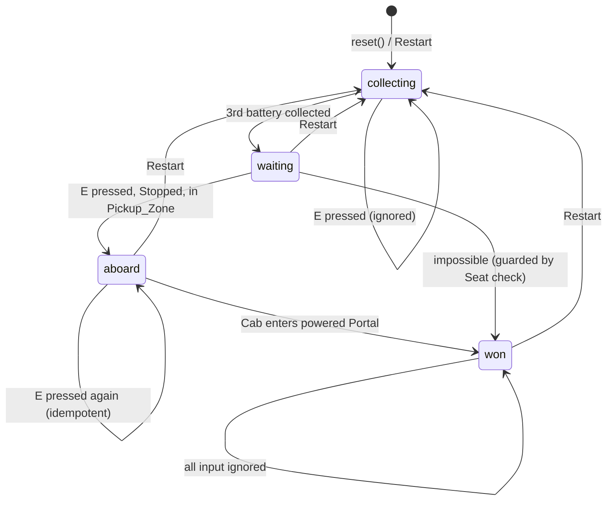

# Design Document

## Overview

The Last Fare extends `index.html`'s existing `update`/`draw*` loop with a passenger pickup-and-delivery mission layered on top of the current battery/portal mechanic. No new files, build steps, or network calls are introduced for the core mission (REQ-LF-01 to REQ-LF-05). The design adds:

- A `missionState` value (`collecting` → `waiting` → `aboard` → `won`) that gates passenger visibility, boarding, and the win condition.
- A `cabStop` constant (position + pickup radius) and a `passenger` object whose `at` field is either `'stop'`, `'seat'`, or `null`.
- An `E`/`e` key handler that attempts a *board* transition, implemented as a single pure function `tryBoard(state, input) -> state` so it can be tested independently of rendering.
- A change to the existing portal-entry check in `update()` so that reaching the powered portal only wins when the seat is occupied, and shows a new hint otherwise.

Requirements REQ-LF-06 and REQ-LF-07 (receipt storage to a local S3-compatible endpoint, and printing) are explicitly out of scope for this design per the requirements document's framing as "planned follow-up scope." This design does not add any network or storage code; it only ensures the `won` transition point is a single, named spot in the code (`enterWon()`) so a later design can hook a receipt write there without re-deriving mission state.

## Architecture

The game remains a single-file, single `<script>` IIFE with no modules, build tooling, or external dependencies — consistent with the existing `index.html`. The Last Fare logic is added as pure, synchronous extensions to the existing `update(dt)` function and existing input listeners; no new animation loop or async code path is introduced.



Logic placement mirrors the existing code's style (plain functions closing over module-level state) rather than introducing a class hierarchy, to stay consistent with the current ~250-line single-file implementation.

## Components and Interfaces

### Mission state (module-level, alongside existing `cab`, `batteries`, `won`)

```js
let missionState;   // 'collecting' | 'waiting' | 'aboard' | 'won'
let passenger;      // { at: 'stop' | 'seat' | null }
```

`won` (the existing boolean) is kept but becomes a derived read: `missionState === 'won'`. Existing code that reads `won` for drawing the win screen and gating `update()` continues to work by replacing `won = true` with a call to `enterWon()` and existing `if (won) return;` checks with `if (missionState === 'won') return;`.

### Cab stop constant

Placed on the horizontal street at row index 2 (`sy(2)`), one vertical street west of the portal's column, at the midpoint between `BATTERY_POS[2]` (centre intersection) and the portal — this keeps it on-street, reachable without leaving streets (streets are fully connected by construction), and clear of any battery, the portal, and `START`:

```js
const CAB_STOP = { x: sx(3), y: sy(2), r: 40 };   // pickup zone radius 40px, per A2
```

`sx(3)` / `sy(2)` are the existing street-centre helper functions already defined in `index.html`; no new coordinate system is introduced. This point sits roughly 150px from the portal and over 400px from `START`/every battery, satisfying the no-overlap part of A2/REQ-LF-01.4 (overlap distances are far larger than the pickup radius of 40px plus the cab half-width of 13px plus any battery/portal pickup radius).

### Functions added

- `isStopped()` → `boolean` — `true` when none of `keys.up/down/left/right` is held (A1). Pure read of existing `keys` object.
- `inPickupZone()` → `boolean` — `Math.hypot(cab.x - CAB_STOP.x, cab.y - CAB_STOP.y) < CAB_STOP.r`.
- `tryBoard(state, input)` → `state'` — **pure function**, the core property-testable unit. Takes an explicit state object (`{ missionState, passengerAt }`) and input object (`{ anyArrowHeld, inZone }`) and returns the next state. No reads of globals, no side effects. The real E-keydown handler calls this with live values and assigns results back to `missionState`/`passenger.at`, and also triggers the hint text as a side effect when (and only when) a transition actually occurred.
- `enterWon()` — side-effecting: sets `missionState = 'won'`. Single call site so a future receipt-write hook has one place to attach.
- `onThirdBattery()` — called from the existing battery-collection loop when `count() === 3`: sets `missionState = 'waiting'`, `passenger = { at: 'stop' }`, powers portal (already implied by `powered()` being derived from `count()`), and sets the new hint text.
- `reset()` (existing function, extended) — additionally resets `missionState = 'collecting'`, `passenger = { at: null }`.

### Input wiring

```js
window.addEventListener('keydown', e => {
  if (e.key in keyMap) { keys[keyMap[e.key]] = true; e.preventDefault(); }
  else if (e.key === 'r' || e.key === 'R') reset();
  else if (e.key === 'e' || e.key === 'E') handleBoardKey();
});
```

`handleBoardKey()` reads live state, calls `tryBoard`, writes back results, and sets the "drive to the portal" hint only on an actual `waiting -> aboard` transition. Key-repeat (REQ-LF-02.7) is naturally handled because `tryBoard` is idempotent from an `aboard` state — see Property 6.

### Rendering changes

- `drawCabStop()` — new function, called from the main `frame()` draw sequence right after `drawPortal()`. Draws the pickup-zone ring only `while missionState !== 'collecting'`, and draws the passenger sprite only `while passenger.at === 'stop'`.
- `drawCab()` (existing, extended) — draws a small passenger silhouette inside the cab body `while passenger.at === 'seat'`.
- `drawHUD()` (existing, extended) — hint text handling is unchanged in mechanism; only the hint *strings* and the triggering call sites change.
- Help text (`#help` div in the existing HTML) gains one line documenting `E` (REQ-LF-05.3).

## Data Models

```js
// Mission state machine
type MissionState = 'collecting' | 'waiting' | 'aboard' | 'won';

// Passenger location — exactly one Passenger exists once revealed
type PassengerLocation = 'stop' | 'seat' | null;   // null before reveal and after restart

interface Passenger {
  at: PassengerLocation;
}

interface CabStop {
  x: number;
  y: number;
  r: number;   // pickup zone radius, px
}

// Pure transition function shape used by tryBoard
interface BoardState {
  missionState: MissionState;
  passengerAt: PassengerLocation;
}

interface BoardInput {
  anyArrowHeld: boolean;
  inZone: boolean;
}
```

No persistence, serialization, or network data models are introduced by this design — REQ-LF-06/07 (Receipt, Ride_ID, Receipt_Store) are deferred to a follow-up design once this mission is in place.

## Correctness Properties

*A property is a characteristic or behavior that should hold true across all valid executions of a system — essentially, a formal statement about what the system should do. Properties serve as the bridge between human-readable specifications and machine-verifiable correctness guarantees.*

### Property 1: Passenger hidden before third battery

For any battery-collection count of 0, 1, or 2 (any subset of the three batteries taken, size < 3), the mission state SHALL be `collecting`, the Portal SHALL be unpowered, and no Passenger SHALL be shown at the Cab_Stop or anywhere else.

**Validates: Requirements 1.1, 1.6**

### Property 2: Third battery reveals passenger and powers portal atomically

For any pre-state with exactly two of the three batteries already taken, collecting the third battery on that same update SHALL transition mission state to `waiting`, power the Portal, and place exactly one Passenger at the Cab_Stop — all as of that single frame, regardless of which two batteries were already taken or which battery is collected third.

**Validates: Requirements 1.2**

### Property 3: Boarding preconditions gate the state transition

For all combinations of mission state (`collecting`, `waiting`, `aboard`, `won`), stopped-ness (any arrow key held or not), and cab position (inside or outside the Pickup_Zone), calling `tryBoard` SHALL transition `passengerAt` from `'stop'` to `'seat'` and mission state from `waiting` to `aboard` if and only if mission state is `waiting`, no arrow key is held, and the cab is inside the Pickup_Zone; in every other combination the returned state SHALL be unchanged from the input state.

**Validates: Requirements 2.1, 2.3, 2.4, 2.5**

### Property 4: Aboard invariant

For any state where `passengerAt === 'seat'`, the Passenger SHALL be considered present inside the Cab and absent from the Cab_Stop, and this SHALL remain true for every subsequent call to `tryBoard` from that state regardless of input.

**Validates: Requirements 2.2, 2.6**

### Property 5: Boarding is idempotent under key repeat

For any state already in `aboard` and any sequence of one or more additional `tryBoard` calls (modeling held or repeated E key presses) with any inputs, the resulting state SHALL equal the single-application result — i.e. `tryBoard(tryBoard(s, i1), i2) == tryBoard(s, i1)` for the mission-state and passenger-location fields.

**Validates: Requirements 2.7**

### Property 6: Delivery requires an occupied seat

For any cab position within the Portal radius of the Portal centre and any mission state, entering the powered Portal SHALL set mission state to `won` if and only if `passengerAt === 'seat'`; when `passengerAt !== 'seat'`, the hint SHALL be set to exactly "Pick up your passenger", mission state SHALL remain unchanged, and the win screen SHALL remain hidden.

**Validates: Requirements 3.1, 3.2, 3.3**

### Property 7: Dark portal entry never changes mission state

For any mission state and any `passengerAt` value, entering the Portal while it is unpowered (fewer than three batteries collected) SHALL leave mission state unchanged and SHALL show the existing hint "The portal is dark. Find all three batteries."

**Validates: Requirements 3.4**

### Property 8: Won state ignores all input

For any input (any combination of arrow keys and/or an E press) applied while mission state is `won`, the cab position, angle, mission state, and passenger location SHALL remain unchanged.

**Validates: Requirements 3.5**

### Property 9: Restart resets mission state unconditionally

For any prior mission state (`collecting`, `waiting`, `aboard`, `won`), any prior passenger location, any prior hint text, and any prior subset of batteries taken, calling `reset()` SHALL result in mission state `collecting`, `passengerAt === null`, no Cab_Stop marker shown, an empty hint, all three batteries marked not taken, and the win screen hidden.

**Validates: Requirements 4.2, 4.3, 4.4, 4.5, 4.6**

### Property 10: Restart triggers are equivalent

For the three restart triggers — pressing `r`, pressing `R`, and activating the Restore button — applying any one of them to the same prior state SHALL produce an identical resulting state (cab position/angle, battery-taken flags, mission state, passenger location, hint).

**Validates: Requirements 4.7**

### Property 11: E key is case-insensitive

For both key values `'e'` and `'E'`, dispatching the corresponding keydown event from the same prior state SHALL produce an identical resulting state.

**Validates: Requirements 5.1**

### Property 12: Window blur releases all held keys

For any subset of `{up, down, left, right}` held at the time of a `blur` event, after the event all four SHALL be released, making the cab Stopped per the definition in A1.

**Validates: Requirements 5.2**

## Error Handling

The core mission has no external I/O, so there are no network, storage, or parsing failures to handle. Error handling is limited to defensive guards against invalid/unexpected input and state, consistent with the existing code's style (the existing game has no try/catch and relies on bounded input):

- **Unknown key events**: `handleBoardKey()` is only invoked for `'e'`/`'E'`; all other keys fall through to existing handling or are ignored, matching current behavior for unmapped keys.
- **Invalid mission state transitions**: `tryBoard` is a pure total function over the four known `MissionState` values and two `PassengerLocation` values relevant to boarding; any combination not matching the `waiting` + stopped + in-zone precondition falls through to the default "return state unchanged" branch, so there is no reachable invalid state.
- **Double-reveal guard**: `onThirdBattery()` is only invoked from the existing `count() === 3` branch, which by construction fires once per battery (each battery's `taken` flag is checked before being set), so the Passenger cannot be revealed twice without an intervening `reset()`.
- **Stale closures across Restart**: because all mission state lives in module-level `let` bindings reassigned by `reset()` (not captured by value in closures), no stale per-run state can leak across a Restart cycle.
- **Out-of-scope follow-up (REQ-LF-06/07)**: this design intentionally does not implement Receipt_Store writes, so failure modes like a down S3-compatible endpoint, partial writes, or malformed Ride_IDs are not handled here and are deferred to the follow-up design referenced in the requirements document.

## Testing Strategy

**Property-based tests** (minimum 100 iterations each, using a JS property-testing library such as `fast-check`) target the pure logic extracted above — `tryBoard`, the battery-count-driven reveal logic, the portal-entry decision, and `reset()` — by modeling game state as plain data objects rather than exercising the live canvas/DOM. Each test is tagged with a comment referencing its design property, e.g.:

```js
// Feature: last-fare, Property 3: Boarding preconditions gate the state transition
```

| # | Property | Generator inputs |
|---|---|---|
| 1 | Passenger hidden before third battery | random subset of batteries taken, size 0–2 |
| 2 | Third battery reveal is atomic | random 2-of-3 pre-taken set + which battery collected third |
| 3 | Boarding preconditions | mission state ∈ 4 values × anyArrowHeld ∈ {true,false} × inZone ∈ {true,false} |
| 4 | Aboard invariant | random state with `passengerAt === 'seat'` + random further `tryBoard` input |
| 5 | Boarding idempotence | random aboard state + 1–5 repeated `tryBoard` calls with random inputs |
| 6 | Delivery requires occupied seat | random cab position (in/out of portal radius) × `passengerAt` ∈ {seat, stop, null} |
| 7 | Dark portal entry | random mission state × random passengerAt, portal forced unpowered |
| 8 | Won ignores input | random key/E combination applied from a `won` state |
| 9 | Restart resets everything | random prior full state (mission state, passengerAt, battery flags, hint, won) |
| 10 | Restart trigger equivalence | same random prior state replayed through each of the 3 triggers |
| 11 | E case-insensitivity | `'e'` vs `'E'` from the same random prior state |
| 12 | Blur releases keys | random subset of 4 held keys |

**Unit/example tests** cover the remaining acceptance criteria that are single fixed scenarios rather than universal properties:

- Cab_Stop marker becomes visible once the Passenger is revealed, and is absent in `collecting` (REQ-LF-01.3).
- `CAB_STOP` coordinates lie on a street cell and are farther than any overlap threshold from `START`, each `BATTERY_POS`, and `PORTAL` (REQ-LF-01.4) — a static geometry assertion, run once.
- Hint text equals "Pick up your passenger" is checked verbatim as part of Property 6's assertions; the two other exact hint strings (REQ-LF-01.5 "drive to the cab stop and press E" wording, REQ-LF-02.8 "drive to the portal" wording) are checked as example tests tied to the exact triggering transition.
- Help text contains a line documenting the E key (REQ-LF-05.3) — a static DOM-content check.

**Integration/non-regression**: a smoke check that the existing driving, collision, trail, and battery-collection behavior is unchanged outside the stated deltas (REQ-LF-05.4) — run as a small set of example-based scenarios reusing the existing `hits()`/`update()` functions, not property tests, since no new input-dependent logic was added to that path.

**Out of scope for this design's tests**: REQ-LF-06 and REQ-LF-07 (Receipt_Store round-trip, Ride_ID display, Print_View) are not implemented or tested here; they belong to the follow-up design.
